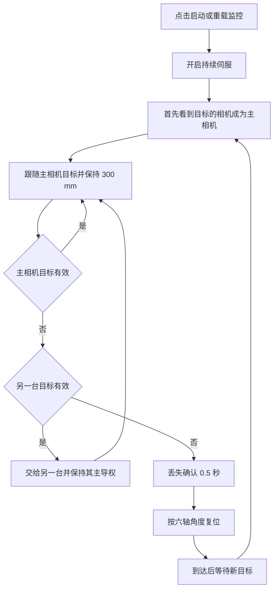
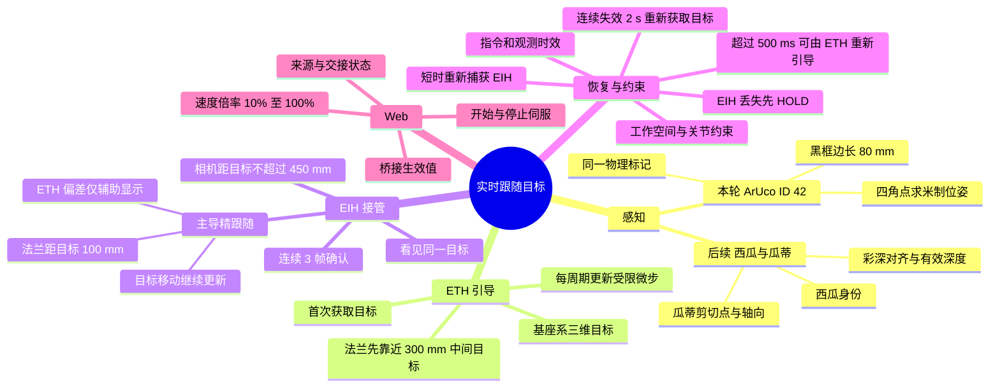

# ID 42 实时跟随与瓜蒂接入

2026-11-23。当前工位按最新要求使用先看到目标的相机主导，主相机丢失后由仍能看到目标的相机接管。跟随参考点为法兰中心，距目标中心 300 mm，法兰 +Z 指向标记。跟随距离沿目标法向计算。机械臂安装、相机内参和手眼文件均应与当前设备一致。

## 最新目标选择与复位

任意相机先获得有效目标即可主导。后来另一台看到目标时保持现有主导权，当前主相机丢失才交给另一台。两路都失效后重新获取时，再选首次看到目标的相机。两路均失效时，默认 0.5 s 后复位至 `[90, -110, 110, -180, -90, 0]` 度。复位结束后等待重新捕获目标，持续伺服会话保持开启。Web 点击启动监控即开启该流程，运行中可调 10%–100% 倍率，关节上限 2 rad/s。

硬件、通信或越界故障进入故障停止，人工停止可撤销持续会话。以下保留前一版 ETH 引导、EIH 近距主导方案，供后续瓜蒂方案对比。当前配置使用 `selection_policy: first_seen`，ETH 优先和旧近距交接分别保留为 `eth_primary`、`handoff` 可选策略。

## 思维导图

## ID 42 的控制逻辑

ETH 首次看到 ID 42 后，定位器输出 COARSE，伺服器按新图像更新法兰的 300 mm 中间目标。每个 20 ms 周期只走一个受限平移与转动微步，桥接再按关节速度和加速度生成 ServoJ 指令。这里的中间点属于局部伺服轨迹，现有工程尚未加入障碍物模型和全局避碰规划。

EIH 看见 ID 42、相机到目标的距离不超过 450 mm，并连续取得 3 帧不同时间戳的有效位姿后，切换到 FINE。初次交接需距最近一次 ETH 粗定位观测不超过 1 s。FINE 每帧用 EIH 更新目标。两台相机的矩阵差异默认作为辅助诊断展示，配置 `require_pair_agreement: true` 可启用原有一致性阻断。

当前默认 `tracking_frame: flange`，最终期望法兰位姿为 `base_T_target × target_T_flange`，其中 `target_T_flange` 的平移为 `[0, 0, -0.10]` m，旋转为单位阵。EIH 手眼继续用于把相机观测转换到基座系。原来的相机参考跟随可用 `tracking_frame: camera` 选择。

EIH 精跟随距离的退出门槛为相机到目标 550 mm。连续有效观测会持续更新法兰目标，到达误差容限后仍继续监听移动目标。EIH 超时或超距时先 HOLD，500 ms 内优先等待 EIH 重新确认。同一目标锁定窗口内，EIH 可独立重新接管。ETH 有有效观测且等待已结束时可重新输出粗定位。连续 2 s 没有被使用的有效目标后，释放锁定，回到 ETH 获取。单帧有效时限仍为 300 ms。

若 HOLD 已触发机器人桥接看门狗停机，恢复视觉后需在 Web 重新点击开始伺服。到达关节限位、工作空间边界、IK 无解或指令失效时，页面会显示原因。默认工作空间只是配置框范围，现场还需核对机械臂实际可达性、奇异位姿和障碍物。

## Web 速度调节

在双画面监控页选择 10%–100% 后点「应用速度」。倍率可在启动前设置，也可在运行中修改。页面显示机器人桥接返回的实际倍率和关节速度上限，调用失败会保留上一次确认的设置。Web 重启后默认 100%。

100% 对应 `max_joint_speed_rad_s`，当前默认 0.15 rad/s。50% 对应 0.075 rad/s。平移微步和转动微步也按倍率调整。关节加速度沿用 `max_joint_accel_rad_s2`，因此降低倍率时会经过受限减速过程。实际法兰速度还受姿态、关节限制、IK、通信及目标距离影响。SDK 的 ServoJ 接口按关节位置序列控制，本工程在指令生成侧调节速度。 [FAIRINO ServoJ 文档](https://fairino-doc-en.readthedocs.io/4.0.1/SDKManual/PythonRobotMovement.html)

## ID 42 现场验收

1. 重启更新后的 Web，启用实体运动时添加 `--allow-motion`。选择四份现场标定文件后重载监控，先看下一步法兰目标与作业区域是否正确。
2. 从低倍率开始，把 ID 42 放在 ETH 可见、EIH 尚未捕获的位置。启动后观察 COARSE 和中间点接近，EIH 捕获后应显示 FINE。
3. 实测法兰中心到标记中心的法向距离是否为 100 mm。移动标记几毫米后暂停，再改变方向移动。观察法兰继续跟随，以及 ETH 退出视野时 EIH 是否持续工作。
4. 在跟随中应用两个不同倍率，检查页面生效值与运动变化。可记录关节位置、目标和指令时间戳，比较跟随误差与时延。
5. 暂时遮住 EIH，检查 HOLD、重新捕获及桥接使能状态。移出目标或工作空间时检查停止输出和页面原因。旧观测超时后，需要重新看到目标才能产生有效指令。

单 ID 仍需要确保工位中恰好一个同 ID 标记。初始 ETH 引导终点应让 EIH 能看见标记，100 mm 法兰间距也应满足相机支架偏移和可视范围。若目标在当前位置进入相机盲区，应调整安装或中间距离，并重新核验手眼关系。

## 西瓜与瓜蒂接入

第一步是明确监督目标。标注西瓜实例、瓜蒂与果实连接点、实际剪切点，以及沿瓜蒂方向的第二个关键点。选择这些关键点能让训练目标对应机械臂需要跟随和对准的位置。采用关键点模型或瓜蒂分割后再拟合中心线，具体以采集的遮挡和分辨率情况评估。Ultralytics 支持自定义关键点训练。 [Ultralytics Pose](https://docs.ultralytics.com/tasks/pose)

接着采集本工位的双相机 RGB-D 数据，覆盖近远距离、光照、遮叶、瓜蒂粗细、相机运动和多个西瓜。训练集与验证集按果实或采集批次划分，避免相邻视频帧跨集合。分别统计西瓜召回率、瓜蒂关键点像素误差、剪切点三维误差、深度有效率、整条链路时延以及丢失后的恢复率。

当前相机节点只发布彩色图像。接入时应增加时间匹配、对齐到彩色视图的深度及其 CameraInfo，检查单位、缺失值和瓜蒂边缘的背景混入。先从有效邻域估计深度，再用相机模型恢复剪切点的三维位置。Orbbec SDK 提供彩深对齐和点云示例。 [Orbbec RGB-D 对齐](https://orbbec.github.io/pyorbbecsdk/source/3_QuickStarts/QuickStart.html)

瓜蒂的三维轴向可由多个有效关键点或局部点云拟合得到，再结合夹具要求定义法兰朝向。单个三维点只约束位置，实际剪切还需要夹具 TCP、剪刀相对法兰变换和可执行的接近方向。这些定义确定后，再把末端跟随参考点从法兰中心切换到剪切 TCP。

多果场景还需要将 EIH 捕获的瓜蒂与 ETH 当前锁定的西瓜关联。建议以目标实例身份、交接时预测视野和三维连续性共同判断，再输出同一剪切点。现有 `Observation` 接口要求米制完整位姿，新的 RGB-D 检测节点需要携带深度与时间戳，不能只把二维框中心写进该接口。

落地顺序为离线回放验证三维剪切点、实机只读观察、低速法兰跟随，最后在夹具 TCP 和避碰验证后接入剪切动作。本轮交付覆盖 ID 42 跟随，瓜蒂模型、数据集与深度发布链路需后续建设。
